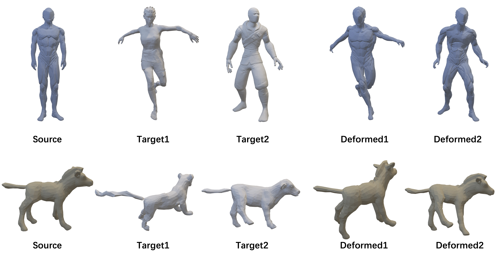

# Weakly-supervised 3D Pose Transfer with Keypoints (ICCV2023)
## [Project Page](https://jinnan-chen.github.io/ws3dpt/) | [Paper](https://arxiv.org/abs/2307.13459)

<p align="center">
  
</p>

The model consists of the followwing steps:\
1.Keypoint detection\
2.Inverse IK\
3.Motion propagation\
4.Mesh refinement

Detailed documentation will be updated.
## Training
bash script.sh

## Testing
bash test.sh

## Citation
If you find our code or paper helps, please consider citing:
```
@article{chen2023weaklysupervised,
  title={Weakly-supervised 3D Pose Transfer with Keypoints},
  author={Chen, Jinnan and Li, Chen and Lee, Gim Hee},
  journal={arXiv preprint arXiv:2307.13459},
  year={2023}
}
